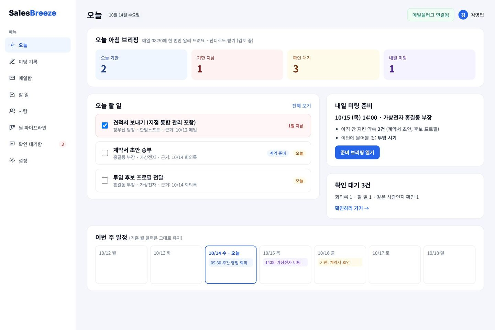
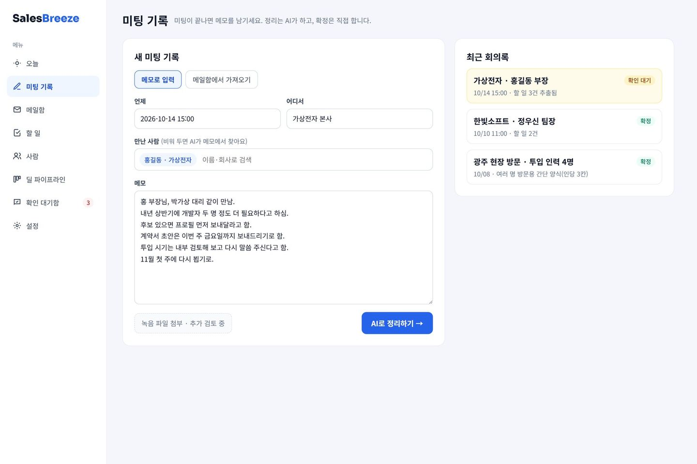
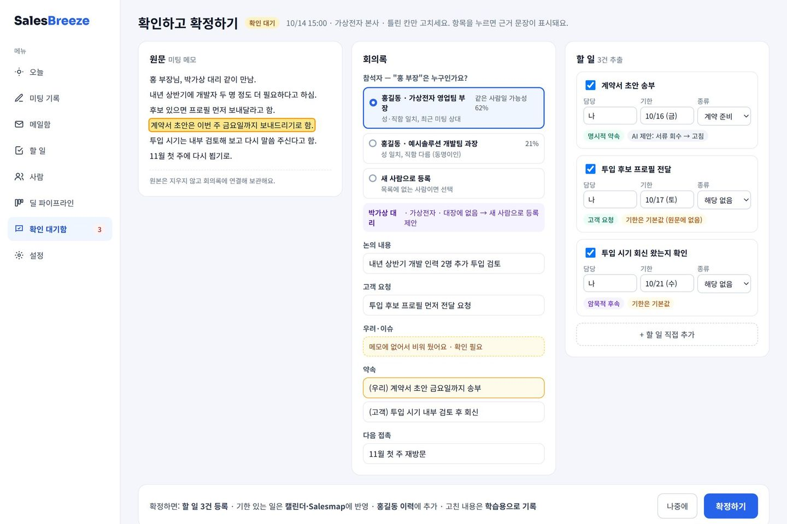
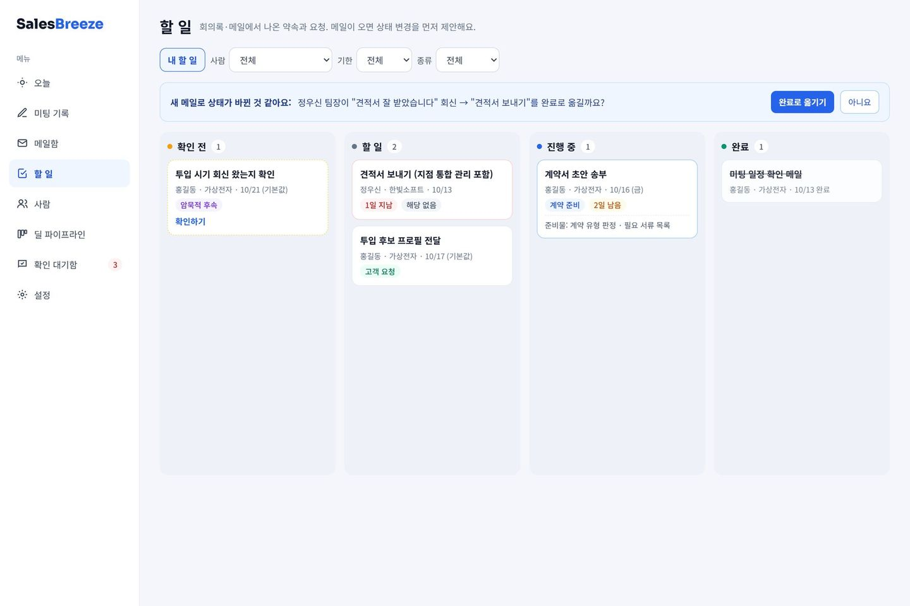
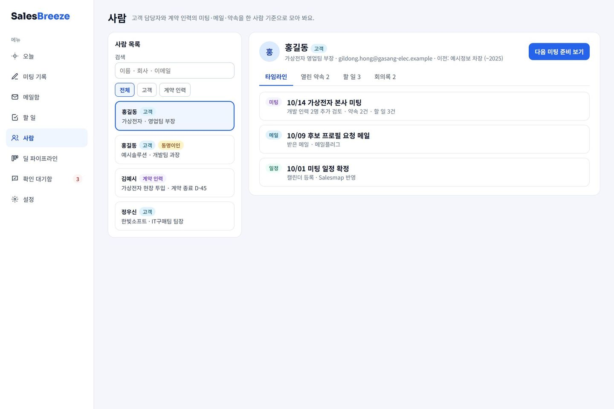
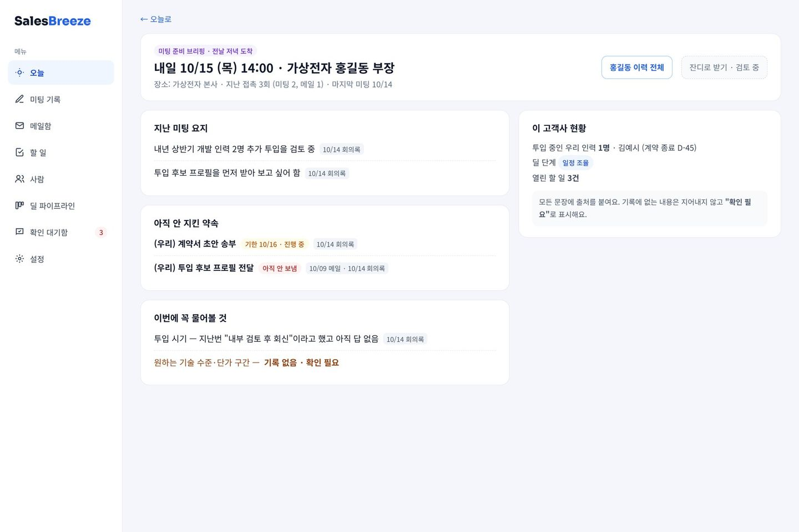

# 목표 화면 6개 (시안)

> 2026-10-13 회사에 공유한 시안. **화면은 각자 자기 기능 것을 만든다** (D-017). 모양은 지금 웹(SalesBreeze)의 틀을 그대로 쓴다: 왼쪽 흰 메뉴 · 카드형(`#f4f6fb` 바탕, 흰 카드, 둥근 모서리) · 파란 포인트 `#2563eb` · 글꼴 Noto Sans KR.
> 시안의 이름·회사는 전부 가짜 데이터(`contracts/examples/`의 홍길동·가상전자 시나리오)다.

## 메뉴 (지금 → 목표)

| 지금 | 목표 | 비고 |
| --- | --- | --- |
| 대시보드 | **오늘** (홈) | 아침 묶음 브리핑 중심 |
| — | **미팅 기록** 🆕 | 메모 입력 + 최근 회의록 |
| Gmail · JANDI | **메일함** | Gmail + 메일플러그. 잔디는 검토 결과에 따라 |
| — | **할 일** 🆕 | 상태별 보드 |
| 고객 타임라인 | **사람** | 고객 담당자 + 계약 인력 |
| 딜 파이프라인 | 딜 파이프라인 | 유지 |
| 처리 이력 | **확인 대기함** | 확인 안 된 회의록·할 일·식별 후보 + 기존 처리 이력 |
| 설정 | 설정 | 메일플러그 연결, 아침 알림 시간 |

## 화면별 담당과 데이터

| # | 화면 | 담당 | 쓰는 데이터 | 재사용할 기존 화면 |
| --- | --- | --- | --- | --- |
| ① | 오늘 (홈) | D | `task`, 브리핑 | `Dashboard.jsx` 브리핑 카드·달력 |
| ② | 미팅 기록 | **B** | 입력 → `meeting_note` | — |
| ③ | 확인 화면 | **B** (틀) + A (참석자 후보 영역) + C (할 일 영역) | `identity_resolution`, `meeting_note`, `task`, `revision` | `MessageView.jsx` 3단 배치 |
| ④ | 할 일 | C | `task` | `PipelinePage.jsx` 보드 |
| ⑤ | 사람 | A | `person`, 이력 | `CustomerTimelinePage.jsx` |
| ⑥ | 미팅 준비 브리핑 | D | 브리핑 (D가 형식 정의) | — |

③ 확인 화면은 세 사람의 영역이 한 화면에 모인다. **B가 화면 틀(3단 배치·확정 버튼)을 만들고, A·C는 자기 영역을 컴포넌트로 만들어 끼운다.** 영역이 아직 없으면 B가 `contracts/examples/` 샘플로 자리만 채운다.

## 시안

### ① 오늘 (홈) — D

아침 묶음 브리핑(오늘 기한·기한 지남·확인 대기·내일 미팅), 오늘 할 일, 내일 미팅 준비, 이번 주 일정.

### ② 미팅 기록 — B

언제·어디서·만난 사람(비워 두면 AI가 메모에서 찾음)·메모 입력 → "AI로 정리하기". 오른쪽은 최근 회의록과 상태(확인 대기/확정). "메일함에서 가져오기"로 메일을 골라도 같은 흐름. 녹음 첨부는 **추가 검토 중** 표시만.

### ③ 확인 화면 — B (A·C 영역 포함)

원문 | 회의록 | 할 일 3단. 회의록 항목이나 할 일을 누르면 원문의 **근거 문장이 강조**된다. 참석자가 애매하면 후보(최대 3) 중 고르거나 새 사람으로 등록. 비운 칸은 "확인 필요" 표시. **확정하기 전엔 아무것도 등록하지 않고**, 고친 값은 전부 `revision`으로 기록한다. 목표: 건당 3분 이내.

### ④ 할 일 — C

확인 전 / 할 일 / 진행 중 / 완료 보드. 새 메일로 상태가 바뀐 것 같으면 위에 제안 배너("완료로 옮길까요?"). 필터: 내 할 일·사람·기한·종류.

> "진행 중" 상태는 아직 `task.schema.json`에 없다 (`decisions.md`의 "논의 중" 참고).

### ⑤ 사람 — A

왼쪽 사람 목록(고객/계약 인력, 동명이인 표시), 오른쪽 상세: 타임라인 · 열린 약속 · 할 일 · 회의록 탭.

### ⑥ 미팅 준비 브리핑 — D

미팅 전날: 지난 미팅 요지, 아직 안 지킨 약속, 이번에 꼭 물어볼 것, 이 고객사 현황. **모든 문장에 출처**(예: "10/14 회의록"), 근거 없는 칸은 "기록 없음 · 확인 필요".

