# 우리 웹 한눈에 보기 — 에이전트 · 화면 · AI가 동작하는 방식

> 2026-11-12 `main` 기준. 화면 캡처와 예시는 모두 **가짜 데이터**(가상물산·예시전자 같은 가상 회사, 데모 메일함)다.
> "지금 무엇이 되고, 누가 만들었고, AI는 어떻게 만들고 검사했나"를 처음 보는 사람도 따라갈 수 있게 정리했다. 결정의 근거는 [`decisions.md`](decisions.md), 목표·일정은 [`overview.md`](overview.md).

## 1. 한 줄 요약

영업 담당자가 고객을 만나거나 메일을 주고받으면, AI가 **상대가 누구인지 찾고 → 회의록을 쓰고 → 할 일을 뽑고 → 때맞춰 준비할 것을 알려 주는** 웹이다. AI는 **제안만** 하고, 확정은 사람이 한다.

## 2. 두 에이전트

```
메일 · 미팅 메모
   │
   ▼
① 기록 담당 (일정관리 에이전트)                         지금
   상대 식별 → 표준 회의록 → 할 일 추출 → [사람 확인] → 수정 기록 → 캘린더 등록
     🔄            ✅            ✅           ✅           ✅           ⬜
   │ 확정한 할 일
   ▼
② 준비 담당 (고객지원 에이전트)
   할 일 종류 판정 → 언제 알릴지 계산 → 자료 모으기 → 준비 안내 → 아침 묶음 브리핑
     ✅ (규칙)          ⬜                 ⬜             ⬜           🔄 (API만)
```

✅ 화면까지 됨 · 🔄 일부 · ⬜ 아직 없음

- **기록 담당**은 "만난 뒤"를 맡는다. 메모·메일을 회의록과 할 일로 바꾸고 사람이 확인한다.
- **준비 담당**은 "다음 만남 전"을 맡는다. 예를 들어 11/26 고객 미팅이 확정돼 있으면, 11/25 아침에 "내일 10시 가상물산 미팅 — 지난번 단가 걱정, 우리가 보내기로 한 제안서 보냈는지 확인" 같은 안내를 하루 1번 묶어서 보낸다.

## 3. 역할 분담

| 담당 | 사람 | 맡은 일 | 지금까지 만든 것 | 남은 것 |
| --- | --- | --- | --- | --- |
| **A** 상대 식별 | 조현우 | 같은 사람 찾기, 인물 대장, 후보 고르는 화면, ML-1 | 가짜 인물 300명·비교 쌍 3,000개, 판정 규칙(D-022), 식별 API, 인물 대장·후보 고르기·새 사람 등록 (#21 #23 #28 #45) | 식별 ID 규칙, 인물 병합·되돌리기, 사람 화면 ⑤, ML-1 학습 모델 |
| **B** 회의록 | 이민재 | 메모·메일 → 회의록, 확인 화면 틀, LLM 비교 | 회의록 엔진·평가셋, 미팅 기록 화면, 3단 확인 화면, 메일 → 회의록, 보관, 할 일 분류 LLM 비교 (#13 #17 #19 #24 #31 #32 #34 #37 #39 #44) | 고른 상대를 참석자 칸에 반영, 메모 약속 주체 구분 개선 |
| **C** 할 일 | 송하경 | 회의록 → 할 일, 11부류 분류, ML-2 | 할 일 추출, 기한 규칙, 11부류 규칙 분류, 할 일 보드, 학습 데이터 정리 (#25 #27) | 할 일 수정 기록을 D로 넘기기, 고객 측 할 일 담당자 비우기 |
| **D** 일정·브리핑 | 유혜림 | 캘린더 등록, 상태 자동 변경, 준비 브리핑, 수정 기록(ML-4) | 수정 기록 저장 API, 아침 묶음 브리핑 API (#26) | **캘린더 등록, 미팅 전날 브리핑(S-01), 오늘 화면 ①·브리핑 화면 ⑥** |
| 총괄 | 이민재 | 리뷰, 연결, 결정 기록, 모델 비교, 메일플러그 | CI 자동 검사, 모델 비교 도구·로컬 LLM 4종 비교, 데이터 권한 결정, 범위·차별성 문서 (#11 #15 #29 #35 #36 #40 #42) | 메일플러그 연결(회사 회신 대기), 설치 문서 |

네 명은 데이터 형식(`contracts/`)만 맞추고 **동시에** 개발한다. 앞 단계가 없으면 가짜 샘플을 입력으로 쓴다.

## 4. 기술 구성

```
화면 (React · Vite)  ──▶  백엔드 (Spring Boot · MySQL · JWT)  ──▶  AI 모듈 (FastAPI)  ──▶  로컬 LLM (Ollama, qwen2.5 7B)
 localhost:5174              localhost:8080                       localhost:8000          PC 안에서 실행
```

- **화면**은 사람이 보고 누르는 곳, **백엔드**는 저장·권한·흐름 연결, **AI 모듈**은 회의록·식별·할 일 엔진이다.
- LLM은 외부 서비스가 아니라 **PC 안에서 돌아가는 공개 모델**이라 메일·메모가 회사 밖으로 나가지 않는다. 유료 API(OpenAI)는 연결만 해 두고 기본은 꺼져 있다.
- 모듈 사이 데이터 형식은 `contracts/*.schema.json`으로 정하고, 테스트가 형식을 검사한다.

## 5. 웹 둘러보기 (실제 화면, 데모 데이터)

데모 데이터 모드(설정)를 켜면 실제 Gmail 대신 가짜 메일함이 쓰인다. 아래는 그 상태에서 실제로 돌린 화면이다.

### 5-1. 대시보드 — 1학기

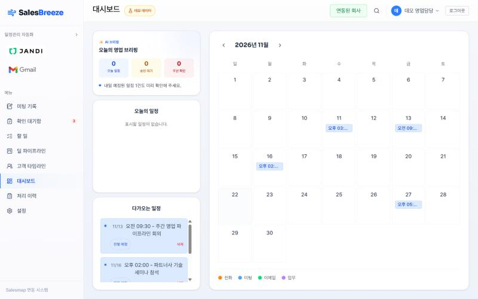

달력에 확정된 일정이 보이고, 왼쪽에 오늘 일정·승인 대기 수가 나온다. 1학기에 만든 "메일 → 일정" 흐름의 결과가 여기 모인다.

### 5-2. 메일함과 메일 분석 — 1학기

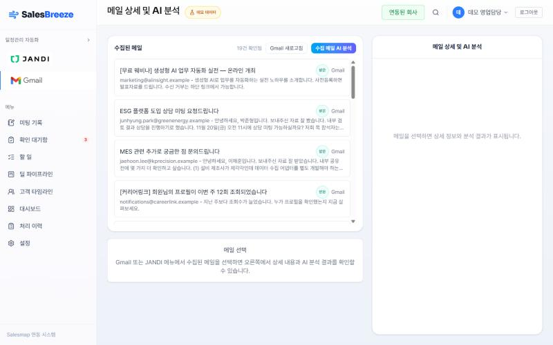

메일을 자동으로 모아 온다. 고객 메일과 웨비나·택배 알림 같은 업무 외 메일이 섞여 있고, 업무 외 메일은 등록 대상에서 빠진다.

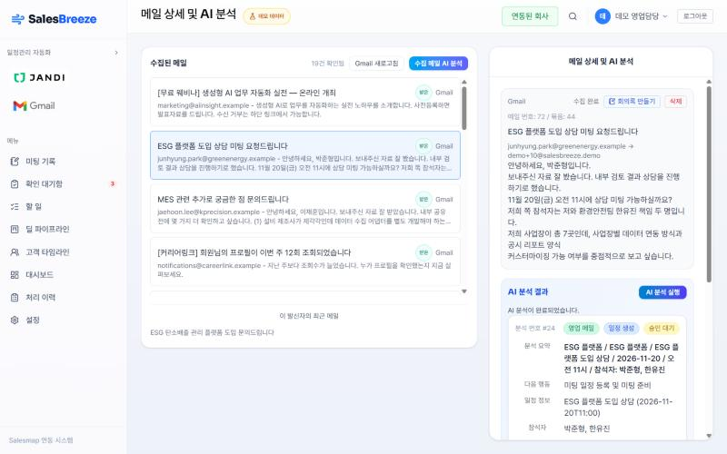

메일을 열고 "AI 분석 실행"을 누르면 오른쪽 아래에 결과가 나온다. 이 예시에서는 **영업 메일 · 일정 생성 · 승인 대기**, 일정 2026-11-20 11시, 참석자 박준형·한유진을 뽑았다. 사람이 확인하고 승인해야 캘린더에 들어간다.

> **어떻게 동작하나:** 날짜·시간·금액·처리 유형은 **규칙(정규식)**이, 고객사·제품·참석자·요약은 **LLM**이 뽑아 합친다. 틀리면 안 되는 값을 LLM에 맡기지 않기 위해서다.

### 5-3. 미팅 기록 — 메모 입력 (B)

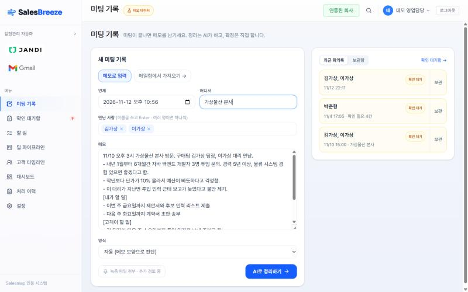

언제·어디서·만난 사람(이름 쓰고 Enter)·메모를 넣고 **"AI로 정리하기"**를 누르면 1분쯤 뒤 회의록 초안이 생긴다. 예시 메모:

```
11/10 오후 3시 가상물산 본사 방문. 구매팀 김가상 팀장, 이가상 대리 만남.
- 내년 1월부터 6개월간 자바 백엔드 개발자 3명 투입 문의. 경력 5년 이상, 물류 시스템 경험 있으면 좋겠다고 함.
- 작년보다 단가가 10% 올라서 예산이 빠듯하다고 걱정함.
- 이 대리가 지난번 투입 인력 근태 보고가 늦었다고 불만 제기.
[내가 할 일]
- 이번 주 금요일까지 제안서와 후보 인력 리스트 제출
- 다음 주 화요일까지 계약서 초안 송부
[고객이 할 일]
- 김 팀장이 다음 주 수요일까지 투입 일정표 보내 주기로 함
[다음 일정]
- 11/26 오전 10시 가상물산 본사에서 고객 미팅 (후보 면접)
- 12/3 부산 물류센터 현장 점검 출장 (같이 가기로 함)
```

메일로 시작하려면 메일 상세의 **"회의록 만들기"**를 누른다(5-2 화면 오른쪽 위).

### 5-4. 확인 대기함

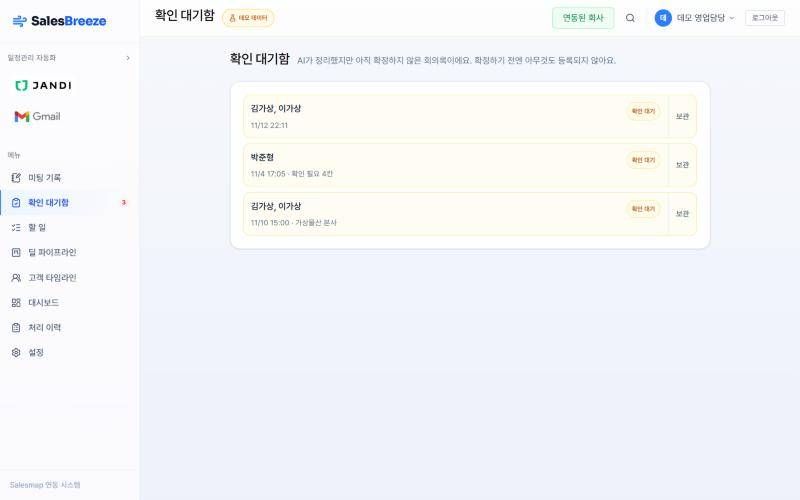

AI가 만들었지만 사람이 아직 확정하지 않은 회의록이 모인다. **확정하기 전에는 아무것도 등록되지 않는다.**

### 5-5. 확인 화면 — 원문 · 회의록 · 할 일 3단 (B 틀 + A 참석자 + C 할 일)

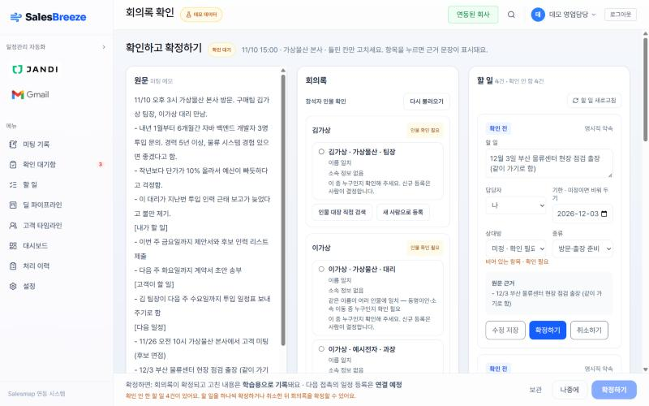

- **왼쪽 원문:** 입력한 메모 그대로.
- **가운데 회의록:** 위쪽 "참석 인물 확인"이 **A의 상대 식별**이다. 김가상은 인물 대장에 한 명뿐이지만 메모에 이름만 있어서 확실로 치지 않고 후보로 보여 준다. **이가상은 동명이인 2명**(가상물산 대리 / 예시전자 과장)을 이유와 함께 보여 주고, 사람이 고른다. 없으면 "새 사람으로 등록". 그 아래가 회의록 5칸(논의 · 고객 요청 · 우려 · 약속 · 다음 접촉).
- **오른쪽 할 일 (C):** 회의록의 약속·다음 일정에서 뽑은 할 일. "12월 3일 부산 물류센터 현장 점검 출장" → 기한 2026-12-03, 종류 **방문·출장 준비**. 상대방이 비어 있으면 "확인 필요"로 표시한다.
- **아래 확정 줄:** 할 일을 **하나씩 확정하거나 취소해야** 회의록을 확정할 수 있다. 확정하면 고친 내용이 학습용으로 기록된다.

이 회의록에서 실제로 나온 할 일:

| 할 일 | 기한 (규칙 계산) | 종류 (규칙 분류) |
| --- | --- | --- |
| 이번 주 금요일까지 제안서와 후보 인력 리스트 제출 | 2026-11-13 | 제안서·인력 제출 |
| 김 팀장이 투입 일정표 보내 주기 (고객 측) — 이행 여부 확인 | 비움 (합의 안 됨) | 해당 없음 |
| 11/26 오전 10시 가상물산 고객 미팅 (후보 면접) | 2026-11-26 | 미팅 준비 |
| 12/3 부산 물류센터 현장 점검 출장 | 2026-12-03 | 방문·출장 준비 |

### 5-6. 근거 강조

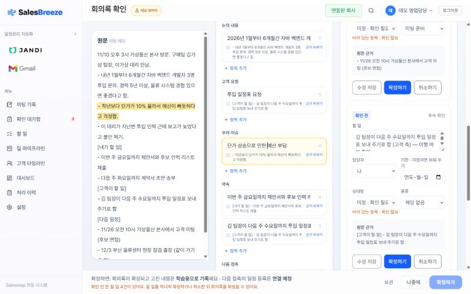

회의록 항목("단가 상승으로 인한 예산 부담")을 누르면 왼쪽 원문에서 **근거 문장이 노랗게 강조**된다. 모든 항목에 근거가 붙어 있어서 AI가 지어낸 내용인지 바로 확인할 수 있다.

### 5-7. 메일로 만든 회의록 — 메일 주소로 확실 식별

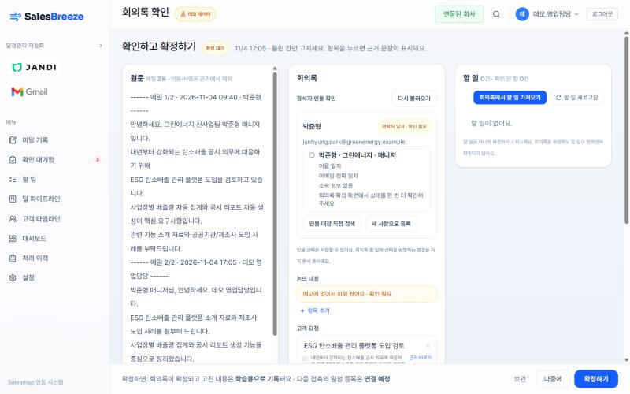

메일 스레드 2통을 원문으로 만든 회의록이다. 인물 대장에 **박준형이 2명** 있지만, 메일 주소가 한 사람과 **정확히 일치**해서 그 사람으로 판정했다("연락처 일치 · 확인 필요" — 확정 전에 사람이 한 번 더 본다). "논의 내용"처럼 원문에 없는 칸은 **비워 두고 "확인 필요"**로 표시한다.

### 5-8. 할 일 보드 (C)

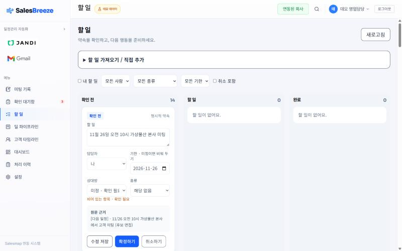

확인 전 · 할 일 · 완료로 나뉜 보드. 사람·종류·기한으로 거를 수 있다.

### 5-9. 보관함 — 지우지 않고 숨기기

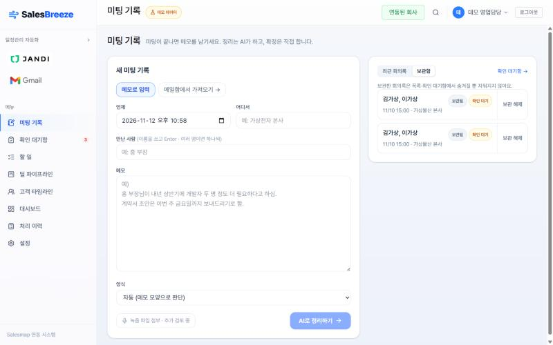

회의록은 삭제 대신 **보관**한다. 확인 대기함에서는 빠지지만 지워지지 않고, 언제든 "보관 해제"할 수 있다. 누가 언제 보관했는지도 남는다(D-025·D-026: 데이터를 지우거나 합치는 결정은 사용자만).

### 5-10. 설정

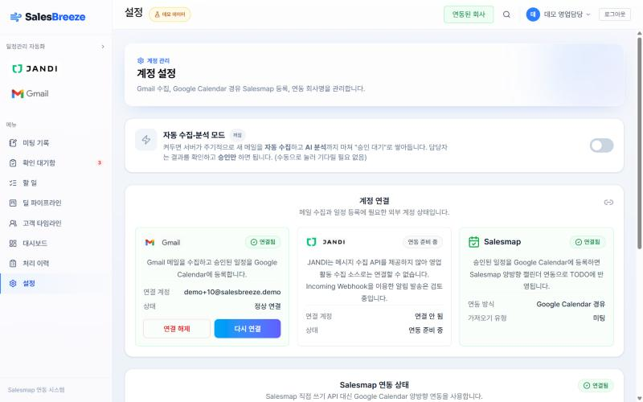

Gmail·잔디·Salesmap 연결 상태와 자동 수집·분석 모드. Salesmap은 Google 캘린더를 거쳐 등록한다.

## 6. 아직 화면이 없는 기능 (시안)

아래는 10/13에 만든 **목표 시안**이다(실제 화면 아님). 자세한 시안 설명은 [`screens.md`](screens.md).

### ① 오늘 (홈) — D

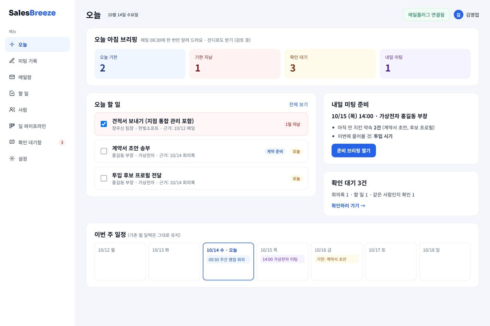

아침 묶음 브리핑(오늘 기한 · 기한 지남 · 확인 대기 · 내일 미팅), 오늘 할 일, 이번 주 일정. **지금은 아침 브리핑 API만 있고 화면은 없다.**

### ⑤ 사람 — A

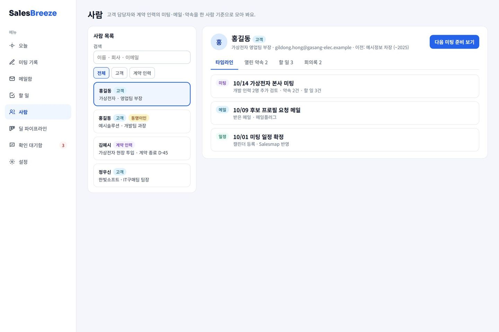

고객 담당자·계약 인력별 만남 이력. **인물 대장 저장·검색은 됐고(#45), 이 화면은 아직 없다.**

### ⑥ 미팅 준비 브리핑 — D

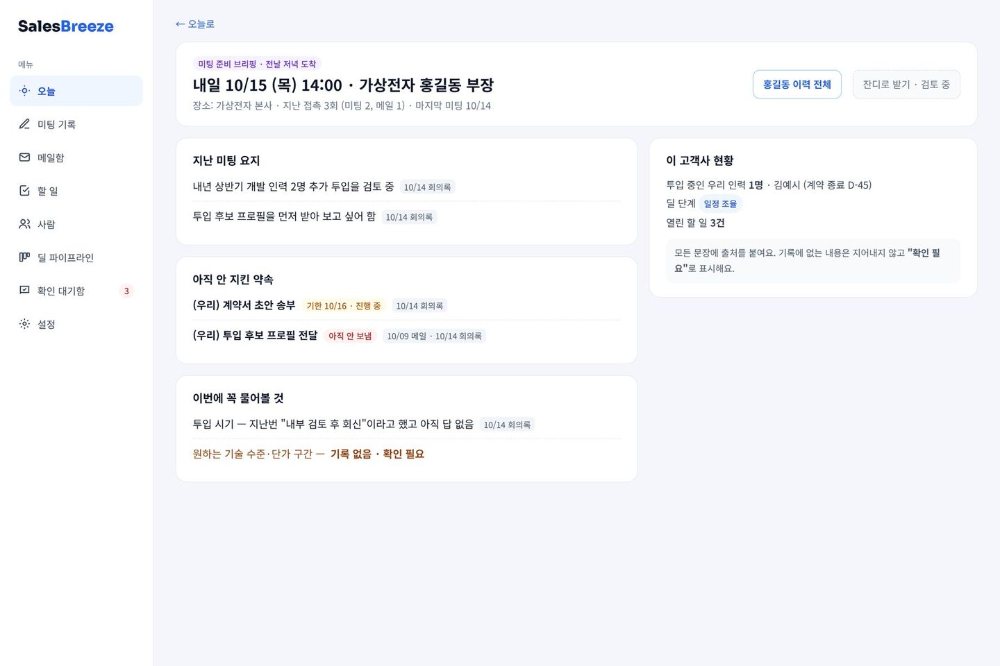

미팅 전날 받는 준비 안내(S-01): 지난 회의 요약, 아직 안 끝난 약속, 만날 사람, 챙길 것. **두 번째 에이전트의 핵심 화면이며 아직 없다.**

그 밖에 아직 없는 것: 확정한 할 일 → **Google 캘린더 등록**(D), 할 일 **상태 자동 변경**(C·D), 회사 메일 **메일플러그 연결**(회사 회신 대기).

## 7. AI는 어떻게 만들고, 무엇으로 검사하나

공통 원칙: **규칙으로 되는 건 규칙으로, 문장 이해가 필요한 것만 LLM으로.** 학습 모델은 규칙 기준을 **이길 때만** 바꾼다. 모든 점수는 **정답을 먼저 만들어 둔 평가 자료**로 잰다.

### 7-1. 메일 분석 (1학기 + 정비)

| 무엇 | 방법 | 결과 |
| --- | --- | --- |
| 날짜·시간·금액·처리 유형 | 규칙(정규식) | — |
| 고객사·제품·참석자·요약 | LLM | — |
| 평가 | 가짜 메일 21통, 사람이 안 고치고 통과시킨 비율 | 규칙만 42.9% → LLM 3B 71.4% → **7B 81.0%** |

3B → 7B 교체는 회의록 점수 차이가 커서 정했다(D-019). 대신 건당 시간이 1.7배 늘었다.

### 7-2. 회의록 (B) — 학습 대신 지시문 조정

- 모델을 따로 학습시키지 않는다. **지시문(프롬프트)**으로 5칸 형식과 규칙을 알려 준다: 항목 하나 = 사실 하나, 고객이 할 일은 `(고객 측)`, 다음 만남은 다음 접촉 칸에만, 모르면 비우기.
- LLM이 쓴 항목마다 **근거 문장을 같이 쓰게** 하고, 프로그램이 그 문장이 **원문에 실제로 있는지 대조**한다. 없으면 버린다(지어낸 내용 차단). 메일은 서명·인용문을 먼저 지운다.
- **평가 자료 20건**(가짜 메모 10 · 가짜 메일 10)에 사람이 정답 회의록을 먼저 써 두고, 항목 단위 F1(정답과 맞춘 정도, 1이 만점)을 잰다.

지시문 조정 기록:

| 언제 | 바꾼 것 | 결과 (F1) |
| --- | --- | --- |
| 10/14 (#17·D-019) | 회의록 엔진 첫 버전, 모델 3B → 7B | 0.586 → 0.821 (메모) |
| 11/2 (#34) | **메일 전용 지시문** 추가. 평가 메일은 건드리지 않고 **개발용 메일 5건**으로만 다듬음 | 메일 3건 0.571 → 0.783 |
| 11/2 (#35) | LLM 무작위성 고정(seed 42) — 같은 입력에 같은 답 | 전에는 같은 지시문으로도 0.80~0.85로 흔들림 |
| 11/2 (#37) | 메일 평가를 3건 → 10건으로 늘림 | 지금 **메모 0.83 · 메일 0.62 · 전체 0.745** |

알려진 약점: 메모에서 우리 약속과 고객 약속을 구분하지 않으면 우리 약속을 `(고객 측)`으로 붙이는 경우가 있다. 그래서 `[내가 할 일]`처럼 나눠 쓰면 정확해진다(개선 과제).

### 7-3. 상대 식별 (A)

- 판정은 세 가지: **확실 / 후보 최대 3명 / 새 사람**. **이메일이나 전화번호가 정확히 맞을 때만 확실**이고, 이름만 같으면 동명이인일 수 있어 후보로 둔다. 새 사람 등록·병합은 사람만 한다(D-022).
- 이름·별칭·소속·이전 소속을 비교하고, 이름 오타 같은 표기 차이는 글자 유사도로 잡는다. 기준값 0.88은 **학습용 자료에서만** 골랐다.
- **데이터:** 가짜 인물 300명 → 비교 쌍 3,000개. 동명이인이 학습·평가에 같이 들어가지 않게 **사람 단위로 240명 / 60명**으로 나눴다 → 학습 2,400쌍(같은 사람 1,189 · 다른 사람 1,147 · 애매함 64) / 평가 600쌍.
- **결과:** 평가 600건에서 정답이 후보 3명 안에 드는 비율 — 정확 일치만 91.7% → 유사도를 더하면 **100%**.
- **임베딩 비교:** 문장 임베딩 모델(BGE-M3)로도 비교했지만 평가 점수가 나아지지 않아 **규칙 유지**.
- **다음:** 같은 사람일 확률을 내는 학습 모델(ML-1: 로지스틱 회귀 → 그래디언트 부스팅). 규칙을 이길 때만 교체.

### 7-4. 할 일 (C) — 추출은 규칙, 종류 분류는 규칙 vs 학습 vs LLM 비교

- 회의록의 **약속·다음 접촉**만 할 일로 만든다. 고객이 하기로 한 일은 "이행 여부 확인" 할 일로 바꾸고 기한은 비운다(우리 일로 착각하지 않게).
- **기한은 규칙으로 계산:** "이번 주 금요일", "다음 주 화요일", "월말"을 만난 날짜 기준으로 계산. 모호하면 비운다. LLM은 쓰지 않는다.
- **11부류 종류 분류:**

| 방식 | 만든 방법 | 기존 평가 55개 | 처음 보는 문장 36개 |
| --- | --- | --- | --- |
| 규칙 (지금 사용) | 부류별 키워드 정규식 | **1.00** | 0.32 |
| 학습 모델 (ML-2) | 할 일 문장 **656개**로 문장 임베딩(MiniLM) + 로지스틱 회귀 | 0.31 | 0.26 |
| LLM 직접 판정 (B 비교, #44) | 11부류 정의·경계표를 지시문으로, qwen2.5 7B / gemma4 | 0.91~0.98 | **0.84~0.93** |

(수치는 macro F1. 36개는 모델을 돌리기 전에 정답을 먼저 정해 커밋했고, 아직 교차 검수 전이다.)

규칙은 만들 때 본 표현에는 완벽하지만 처음 보는 표현("발주처", "이력서 묶어 보내기")을 놓친다. LLM은 처음 보는 표현을 잘 맞히지만 해당 없는 문장에 억지로 종류를 붙여 쓸데없는 알림을 만들 수 있다. 그래서 **"규칙이 모를 때만 LLM에 묻고 확인 필요로 표시"**하는 방식을 11/20에 정한다.

### 7-5. 로컬 LLM 비교 (총괄, L-2)

설정 하나(`OLLAMA_MODEL`)만 바꿔 같은 코드·같은 평가로 돌렸다.

| 모델 | 메일 분석 (무수정 통과) | 회의록 F1 (20건) | 회의록 1건 시간 (CPU) | 실제 RAM |
| --- | --- | --- | --- | --- |
| qwen2.5:7b (지금 기본값) | **81.0%** | 0.745 | 66.9초 | 4.7GB |
| gemma4:e4b | 66.7% | **0.838** | 24.8초 | 6.9GB |
| qwen3.5:4b | 71.4% | 0.609 | 51.5초 | 3.4GB |
| kanana 8B (비공식 변환본) | 71.4% | 0.606 | 44.4초 | 5.2GB |

모두 동작했지만 과제마다 1등이 달라 기본값을 유지했다(D-027). 회의록만 gemma4로 나눌지는 11/20에 정한다.

### 7-6. 수정 기록 (D, ML-4) — 사람의 결정이 다음 학습 자료가 된다

사람이 **그대로 승인했는지, 고쳤는지, 어떤 후보를 골랐는지, 새로 등록했는지**를 모두 기록한다(`contracts/revision.schema.json`). 이 기록은 ① 학습 모델을 다시 학습시킬 정답 ② "사람이 얼마나 고쳐야 했나"를 재는 지표(무수정 승인률·항목별 수정률)로 쓴다. 보관·삭제처럼 AI 제안 없이 사람이 먼저 한 일은 수정 기록이 아니라 그 데이터에 "누가·언제"로 남긴다(D-026).

### 7-7. 평가를 믿을 수 있게 하는 장치

- **정답 먼저:** 모델을 돌리기 전에 정답을 만들고 커밋한다.
- **개발용 / 평가용 분리:** 지시문은 개발용 자료로만 다듬고, 평가 자료는 점수 잴 때만 쓴다.
- **교차 검수:** 정답은 만든 사람이 아닌 팀원이 검수한다.
- **재현:** LLM 무작위성을 고정(seed 42)해 같은 입력에 같은 결과가 나오게 한다.
- **한계:** 모두 팀이 만든 가짜 자료다. 실제 자료에서 이름을 가린 것을 받으면 다시 잰다.

## 8. 지키는 원칙 (요약)

1. 실제 고객·인물 데이터는 쓰지 않는다 (가짜 데이터만)
2. AI는 제안만, 확정·병합·삭제는 사람이
3. 모르면 비워 두고, 뽑은 내용엔 원문 근거
4. 날짜·기한·상태는 규칙으로
5. 사람이 고친 값은 모두 기록
6. 알림은 하루 1번 묶음이 기본
7. 유료 API는 기본으로 끔, 외부 발송은 대기함까지만

## 9. 직접 돌려 보기

실행 방법은 README의 "실행" 절. 서버 3개(AI 모듈 8000 · 백엔드 8080 · 화면 5174)와 MySQL, Ollama(`qwen2.5:7b`)가 필요하다. 계정 없이 둘러보려면 로그인 후 **설정 → 데모 데이터 모드**를 켜면 가짜 메일함이 생긴다.
